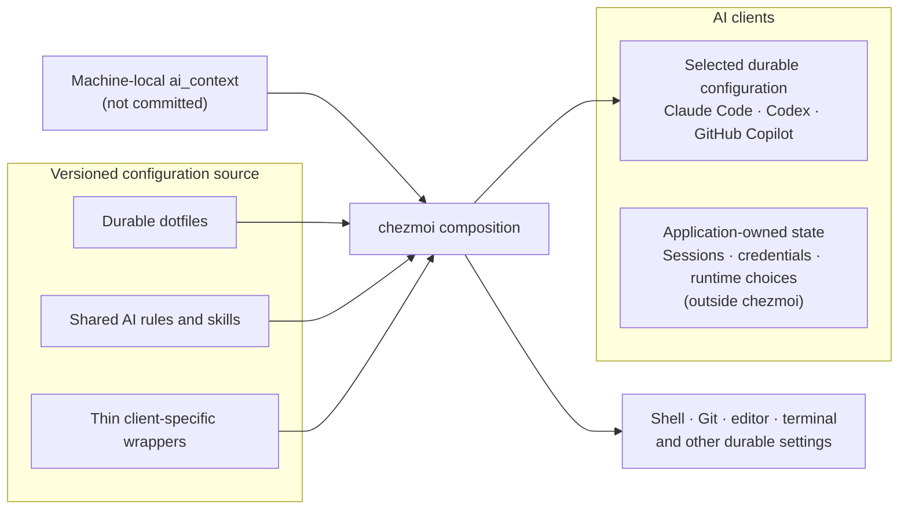

# My Personal Dotfiles and AI Configurations

[繁體中文](./README.zh-TW.md)

**A versioned source of truth for the durable settings and shared AI guidance that shape my development environment.**

This is my personal setup, published as a reference to the choices behind it; it is not meant to be installed unchanged. The repository contains durable settings and shared AI guidance, but not application or account data such as credentials and session history.

## Why I built it

Machines and development tools change, so dotfile settings can drift across machines; AI guidance can also drift across AI clients such as Claude Code, Codex, and GitHub Copilot.

The design focuses on a few practical outcomes:

- **Repeatable setup:** bootstrap scripts install the tools I use; chezmoi applies the durable settings I choose to carry across machines.
- **Selective configuration:** I version the durable settings I want shared and leave changeable or unlisted preferences to each client. For example, this repository manages Claude Code's hooks and status line, while Claude Code keeps its model and effort choices.
- **Consistent AI guidance:** one canonical source for shared rules and skills reduces drift across clients.
- **Preview before applying:** Git shows source edits, and `chezmoi diff` previews their effect on this machine so I can catch unwanted changes before they reach my home directory.

## How it fits together

Shared rules and portable skills use common sources; client-specific instructions, skills, and settings stay scoped to the clients that support them.

chezmoi renders the versioned source with the machine-local profile. I edit the readable source files here, review the rendered changes, then apply them to my home directory. Each client continues to own its sessions, credentials, and runtime state.

## Workflows worth exploring

| Goal | Start with | What it does |
| --- | --- | --- |
| Share AI guidance across clients | [Customization support guide](./docs/customization-support.md) | Reusable rules and skills reach supported Claude Code, Codex, and GitHub Copilot surfaces; client-specific behavior stays scoped to the clients that support it. |
| Take a request to a reviewable change | [End-to-end task guide](./docs/run-task-end-to-end.md) | Takes a request through repository and material checks, implementation, and verification to a local commit or requested PR/MR. |
| Keep and find task decisions across AI sessions | [Personal task-record guide](./docs/task-record.md) | Keeps one personal record of questions, sourced answers, decisions, and next actions, so later AI sessions can resume work or revisit its rationale. |

## Day-to-day conveniences and safeguards

| Feature | What it does | Inspect |
| --- | --- | --- |
| Claude Code statusline (Bash and PowerShell) | Shows the model, session, Git context, and available usage windows in a width-aware display. | [Bash](./home/dot_claude/claude-session-statusline.sh), [PowerShell](./home/dot_claude/claude-session-statusline.ps1) |
| Desktop notifications (Windows and macOS) | Alerts for completed turns, Claude subagents, and tool approvals in terminal and VS Code sessions. | [Windows](./home/dot_local/share/show-agent-notification.ps1), [macOS](./home/dot_local/share/show-agent-notification-macos.sh), [Claude settings](./home/.chezmoitemplates/claude/settings-durable.json), [Codex hooks](./home/dot_codex/hooks.json.tmpl) |
| Local validation | The pre-commit hook renders and validates staged source in a temporary directory without changing home files, then runs relevant guidance, statusline, and link checks. | [Hook](./scripts/git-hooks/pre-commit), [test runner](./scripts/tests/run-git-bash-tests.ps1) |
| Personal or work AI setup | Machine-local `ai_context` selects the guidance and defaults without committing that choice. | [`ai-profile`](./home/dot_agents/skills/ai-profile/SKILL.md), [profile setup](./docs/chezmoi-workflow.md#machine-local-ai-context) |
| Project material storage and indexing | Keeps stable references, reusable test inputs, personal task records, and human-facing handoffs in separate folders. | [Project material rules](./home/.chezmoitemplates/core.md#project-material), [ADR-0057](./docs/decisions/0057-use-durable-personal-task-records.md) |
| Security and verification safeguards | Shared rules cover input validation, output escaping, secret hygiene, and evidence-backed completion claims. | [Shared core rules](./home/.chezmoitemplates/core.md), [ADR-0024](./docs/decisions/0024-instruction-provenance-and-material-filing.md) |

**Statusline example.** The model and usage figures show one past session.

## Where things live

| Path | What you will find |
| --- | --- |
| [`home/`](./home/) | The desired configuration state managed by chezmoi. |
| [`home/.chezmoitemplates/`](./home/.chezmoitemplates/) | Reusable settings, instruction bodies, and templates. |
| [`home/dot_agents/skills/`](./home/dot_agents/skills/) | Shared and client-gated AI skill sources. |
| `home/dot_<client>/` | Client-specific configuration and thin wrappers that connect shared guidance. |
| [`scripts/`](./scripts/) | Bootstrap, diagnostics, and validation tools. |
| [`docs/`](./docs/) | Setup steps, the customization source map, operating guides, and architecture decision records (ADRs). |

## Start here

- [Set up a machine](./docs/setup.md)
- [Understand how managed settings are edited and applied](./docs/chezmoi-workflow.md)
- [Find where an AI client setting or skill comes from](./docs/customization-support.md)
- [Review current architecture decisions](./docs/decisions/README.md)

Before applying anything to your home directory, review the setup guide and run `chezmoi diff` for your machine.
