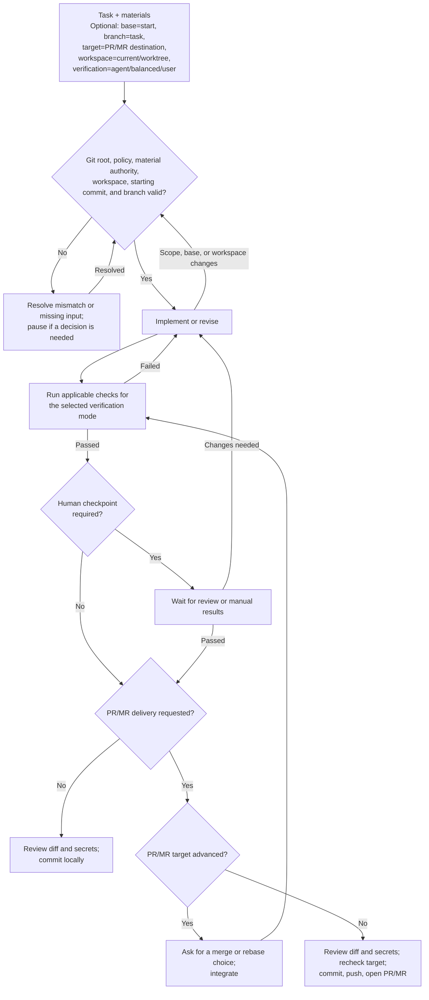

# Run an implementation task end to end

[繁體中文](./run-task-end-to-end.zh-TW.md)

The [`run-task-end-to-end` skill](../home/dot_agents/skills/run-task-end-to-end/SKILL.md) takes an implementation request through workspace checks, verification, and a local commit or requested PR/MR. The skill is the authoritative source for agent behavior; this guide explains the choices and flow for readers. For planning or code review without implementation, ask the agent directly.

## Invoke the skill

Select `run-task-end-to-end` in your client, then provide the task and any optional choices. For example:

`Update the VS Code keybindings from the attached spec; base=main target=main workspace=current verification=balanced`

Claude Code and Copilot accept `/run-task-end-to-end` directly. In Codex CLI or its IDE extension, use `/skills` to select the skill or mention `$run-task-end-to-end`.

The example uses the primary checkout because this repository does not allow worktree edits. Other repositories may permit `workspace=worktree`. State choices in plain language or as optional `key=value` hints; they are not a required command format.

## Choose a starting point, delivery, and verification

`base` names the starting branch or commit; `branch` requests a specific task-branch name. `target` names the PR/MR destination and requests publication. If only `target` is supplied, the skill also uses it as the starting point unless repository policy says otherwise. Without either `base` or `target`, the skill uses and records the current checkout's or client worktree's starting commit; it never infers a publication target. `workspace` selects the current checkout or a permitted worktree. The skill follows repository branch policy and creates a task branch when policy or delivery requires one.

`verification` controls the human checkpoint. With `agent`, the agent runs useful available automated, runtime, and browser checks and asks only for access or judgment it lacks. `balanced` adds your review before committing or publishing. With `user`, the agent runs automated checks only, provides manual test steps, and waits for your results. Local delivery defaults to `agent`; requested publication defaults to `balanced`.

The agent continues routine implementation, corrections, and verification until the requested result is complete. It pauses for a required decision, the selected human checkpoint, or a concrete blocker.

## Follow the workflow

The return arrows show when earlier checks must be repeated. Resolved inputs or changes to scope, starting point, or workspace return to readiness checks. Failed verification or requested changes return to implementation. If the PR/MR target advances, the skill waits for a merge or rebase choice, then repeats affected checks and any required human checkpoint before rechecking the target. For a substantial task that spans sessions, [`task-record`](../home/dot_agents/skills/task-record/SKILL.md) keeps the questions, decisions, current state, and next action in one personal file. A continuing session checks it against Git and source material.

## Work across projects in parallel

Use a separate native client task or session for each independent workstream, and verify that each one is attached to the intended repository and workspace before editing. Different repositories can progress independently. For concurrent changes in the same repository, use separate worktrees when its policy allows them; avoid concurrent edits to the same checkout. A worktree isolates files and branch state, but project services such as ports, databases, and caches may still be shared, so follow the project's runtime setup.

Keep task context with the work that needs it: use the repository's instructions and checks, and use [`task-record`](../home/dot_agents/skills/task-record/SKILL.md) when substantial work spans sessions or needs durable decisions. For frontend changes that affect rendered UI, use [`web-ui-verification`](../home/dot_agents/skills/web-ui-verification/SKILL.md). This is a working pattern, not a central scheduler; use the clients' native task and worktree support.
