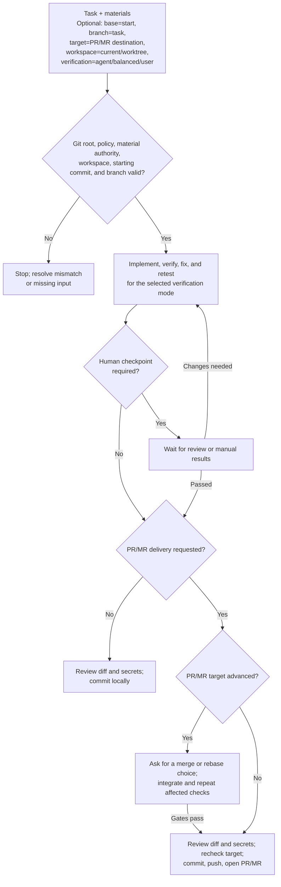

# Run an implementation task end to end

[繁體中文](./run-task-end-to-end.zh-TW.md)

The [`run-task-end-to-end` skill](../home/dot_agents/skills/run-task-end-to-end/SKILL.md) takes an implementation request through workspace checks, verification, and a local commit or requested PR/MR. The skill is the authoritative source for agent behavior; this guide explains the choices and flow for readers. For planning or code review without implementation, ask the agent directly.

## Invoke the skill

Select `run-task-end-to-end` in your client, then provide the task and any optional choices. For example:

`Update the VS Code keybindings from the attached spec; base=main target=main workspace=current verification=balanced`

Claude Code and Copilot accept `/run-task-end-to-end` directly. In Codex CLI or its IDE extension, use `/skills` to select the skill or mention `$run-task-end-to-end`.

The example uses the primary checkout because this repository does not allow worktree edits. Other repositories may permit `workspace=worktree`. State choices in plain language or as optional `key=value` hints; they are not a required command format.

## Choose a starting point, delivery, and verification

`base` names the starting branch or commit; `branch` requests a specific task-branch name. `target` names the PR/MR destination and requests publication. If only `target` is supplied, the skill also uses it as the starting point unless repository policy says otherwise. Without either `base` or `target`, the skill uses and records the current checkout's or client worktree's starting commit; it never infers a publication target. `workspace` selects the current checkout or a permitted worktree. The skill follows repository branch policy and creates a task branch when policy or delivery requires one.

`verification` controls the human checkpoint. With `agent`, the agent runs useful available automated, runtime, and browser checks and asks only for access or judgment it lacks. `balanced` adds your review before committing or publishing. With `user`, the agent runs automated checks only, provides manual test steps, and waits for your results. Local delivery defaults to `agent`; requested publication defaults to `balanced`.

The agent continues routine implementation, corrections, and verification until the requested result is complete. It pauses for a required decision, the selected human checkpoint, or a concrete blocker.

## Follow the workflow

If the PR/MR target has advanced since the recorded checkpoint, the skill waits for a merge or rebase choice and reruns affected checks before publication. If another session needs to continue the task, use [`task-handoff`](../home/dot_agents/skills/task-handoff/SKILL.md) to capture the current state when transferring the work.
