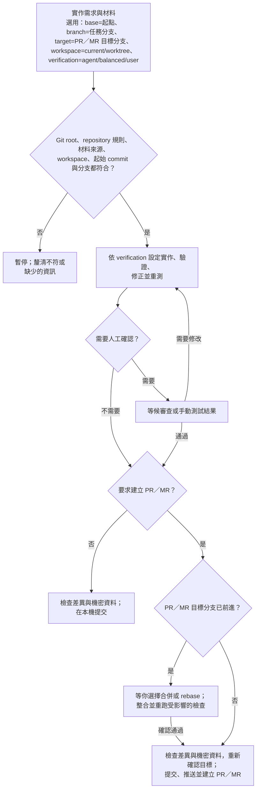

# 從實作到交付：端到端任務流程

[English](./run-task-end-to-end.md)

[`run-task-end-to-end` skill](../home/dot_agents/skills/run-task-end-to-end/SKILL.md) 會從實作需求開始，確認工作目錄、完成驗證，最後在本機提交，或依要求建立 PR／MR。AI 實際遵循的步驟以 skill 來源檔為準；本指南說明使用者可選的條件與整體流程。若只要規劃或檢查程式，直接請 AI 協助即可。

## 呼叫 skill

先在使用的 client 選擇 `run-task-end-to-end`，再輸入任務與選用條件。例如：

`依附上的規格調整 VS Code 快捷鍵；base=main target=main workspace=current verification=balanced`

Claude Code 與 Copilot 可直接使用 `/run-task-end-to-end`；Codex CLI／IDE 可透過 `/skills` 選擇 skill，或用 `$run-task-end-to-end` 指名。

這個例子在主要 checkout 操作，因為這個 repository 不允許在 worktree 修改來源檔。其他 repository 若允許使用 worktree，才可指定 `workspace=worktree`。這些選擇可用自然語言或選用的 `key=value` 提示交代，不必遵循固定的指令格式。

## 選擇起點、交付方式與驗證方式

`base` 指定工作起點（分支或 commit）；`branch` 可指定任務分支名稱。`target` 指定 PR／MR 目標分支，同時表示要發布。只給 `target` 時，除非 repository 規則另有要求，skill 也會用它作為起點。兩者都沒給時，skill 會確認並記錄目前 checkout 或 client worktree 的起始 commit，不會自行推測發布目標。`workspace` 指定目前 checkout 或 repository 規則允許的 worktree。skill 會遵守 repository 的分支規則，並在規則或交付方式需要時建立任務分支。

`verification` 決定人工確認的方式。選擇 `agent` 時，AI 會執行可行的自動化、執行時及瀏覽器檢查，只在需要你的權限或判斷時請你協助；`balanced` 會在提交或發布前再等候你審查；`user` 則由 AI 執行自動化檢查、提供手動測試步驟，再等候你的結果。本機交付預設使用 `agent`，要求發布時則預設使用 `balanced`。

AI 會持續實作、修正並驗證，直到完成要求的結果；只有遇到必要決策、選定的人工確認環節或具體阻礙時才會暫停。

## 流程概覽

若 PR／MR 目標分支自記錄時起已前進，skill 會先等你選擇合併或 rebase，再重跑受影響的檢查，才繼續發布。較複雜、需要跨 session 進行的任務，會用 [`task-record`](../home/dot_agents/skills/task-record/SKILL.md) 在一份個人檔案中保留問題、決策、目前進度與下一步；接手的 session 會對照 Git 和原始資料重新確認。
