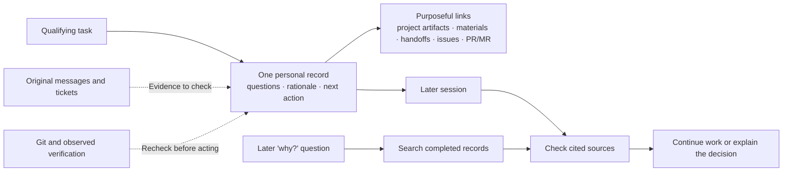

# Personal task records

[繁體中文](./task-record.zh-TW.md)

The [`task-record` skill](../home/dot_agents/skills/task-record/SKILL.md) keeps the reasons behind a task's decisions and its unanswered questions available across AI clients and sessions. The skill defines agent behavior; this guide shows when a personal record helps and how it relates to other sources. Records live in `~/Documents/task-records/{repo}/`, outside this repository and chezmoi.

## When to use one

Keep one record for a task that awaits a consequential external answer, has a decision whose rationale will matter later, or is likely to span sessions. A self-contained task whose context is recoverable from the request and Git needs no record. For a later question about *why* a choice was made, search completed records without creating a new one.

## How the record fits

The record is a concise personal index and decision history, not a team publication or session-by-session log. Revise its existing summary at material updates and keep closed implementation details to results and links. Original messages and tickets remain evidence of external requests and answers; Git remains authoritative for code state. When teammates need to review or maintain a decision, gap, or open item, keep it in the project's canonical issue, ADR, documentation, or handoff and link it from the record. Do not create a parallel team log. When resuming, check Git and cited sources before acting; the record is not live status. Avoid routine branch, HEAD, and clean/dirty snapshots, keeping a dated checkpoint only when another checkout, uncommitted work, or an in-progress publication changes the next action. Related materials, reusable test inputs, and human-facing handoffs stay in their own locations and are linked by purpose.

The [record format](../home/dot_agents/skills/task-record/references/record-format.md) shows the fields. [ADR-0057](./decisions/0057-use-durable-personal-task-records.md) explains why this replaced the old `task-handoff` snapshot; [ADR-0061](./decisions/0061-keep-task-records-concise-and-project-outputs-canonical.md) refines the resume checkpoint and team-artifact boundary. The [end-to-end task guide](./run-task-end-to-end.md) covers implementation, verification, and delivery; the record preserves context when that work spans sessions.
