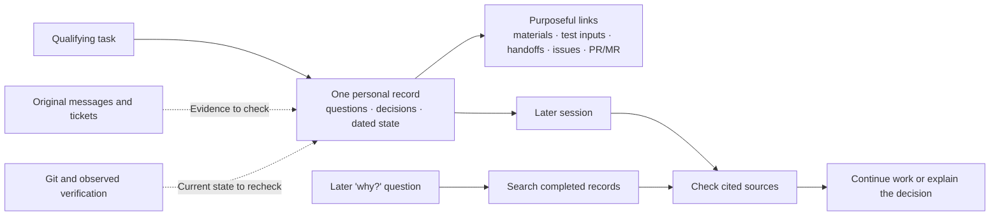

# Personal task records

[繁體中文](./task-record.zh-TW.md)

The [`task-record` skill](../home/dot_agents/skills/task-record/SKILL.md) keeps the reasons behind a task's decisions and its unanswered questions available across AI clients and sessions. The skill defines agent behavior; this guide shows when a personal record helps and how it relates to other sources. Records live in `~/Documents/task-records/{repo}/`, outside this repository and chezmoi.

## When to use one

Keep one record for a task that awaits a consequential external answer, has a decision whose rationale will matter later, or is likely to span sessions. A self-contained task whose context is recoverable from the request and Git needs no record. For a later question about *why* a choice was made, search completed records without creating a new one.

## How the record fits

The record is a personal index and decision history. Original messages and tickets remain evidence of external requests and answers; Git remains authoritative for code state. Current-state fields are dated snapshots, so a continuing agent checks them against the checkout and cited sources before acting. Related materials, reusable test inputs, and human-facing handoffs stay in their own locations and are linked by purpose.

The [record format](../home/dot_agents/skills/task-record/references/record-format.md) shows the fields. [ADR-0057](./decisions/0057-use-durable-personal-task-records.md) explains why this replaced the old `task-handoff` snapshot. The [end-to-end task guide](./run-task-end-to-end.md) covers implementation, verification, and delivery; the record preserves context when that work spans sessions.
