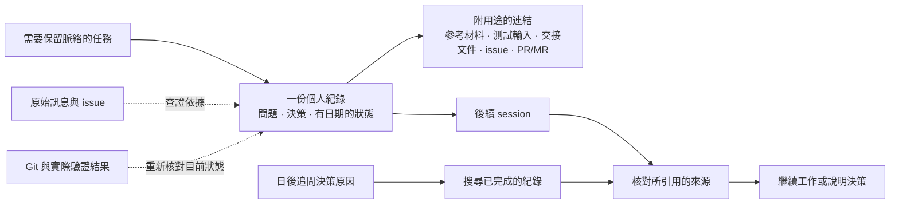

# 個人任務紀錄

[English](./task-record.md)

[`task-record` skill](../home/dot_agents/skills/task-record/SKILL.md) 讓不同 AI client 與 session 都能找到任務中的決策理由和待釐清問題。skill 定義 agent 的處理方式；本指南說明何時需要個人紀錄，以及它與其他資料來源的關係。紀錄放在 `~/Documents/task-records/{repo}/`，不屬於這個 repository，也不由 chezmoi 管理。

## 什麼時候需要紀錄

如果任務正等待會影響後續工作的外部答覆、某項決策的理由日後可能需要查證，或工作可能跨越多個 session，就為該任務保留一份紀錄。若請求和 Git 已足以還原一項簡單工作的脈絡，就不必建立紀錄。日後想查「當初為什麼這樣做」時，可搜尋已完成的紀錄，不必為查詢另建一份。

## 紀錄與其他資料的關係

這份紀錄是個人的任務索引與決策歷程。外部請求和答覆仍以原始訊息或 issue 為準；程式碼狀態則以 Git 為準。「目前狀態」只是當時留下的快照，接手的 agent 必須先對照工作目錄與引用來源，再依紀錄行動。參考材料、可重用的測試輸入和對外交接文件保留在各自的位置，紀錄只附上有用途的連結。

[紀錄格式](../home/dot_agents/skills/task-record/references/record-format.md)列出可使用的欄位。[ADR-0057](./decisions/0057-use-durable-personal-task-records.md)說明為何以此取代舊的 `task-handoff` 快照。[端到端任務指南](./run-task-end-to-end.zh-TW.md)涵蓋實作、驗證與交付；跨 session 工作需要保留的脈絡則由任務紀錄承接。
